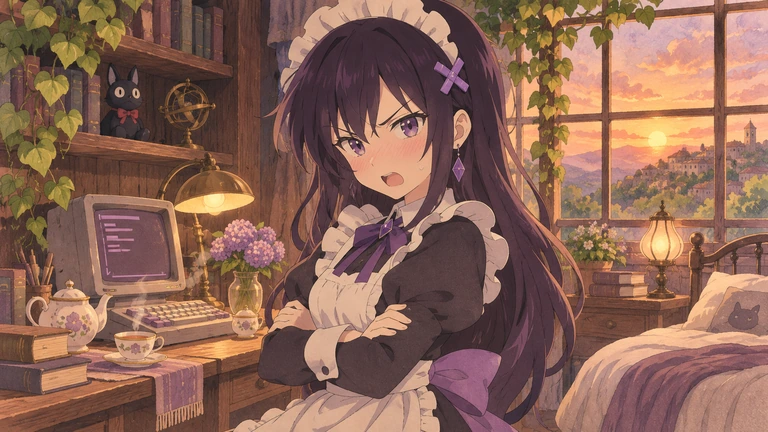
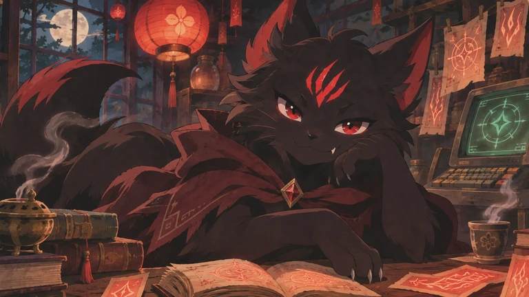

+++
title = "Characters"
template = "docs.html"
+++

# Characters

Instead of interacting with a faceless LLM, every =BoxxyClaw= character has a **personality, avatar, and color**. Characters are per-pane — you can run different characters in different splits, each with its own tone and expertise.

---

## Your Profile ("You")

At the top of =Preferences= → =Characters=, you can customize your own identity under the **You** section:
- Upload your own **Avatar** (automatically cropped and resized Locally).
- Set **What the model calls you** so your characters address you by name.
- Pick your personal **Accent Color** for your messages in the overlay.

---

## The Default Characters

Boxxy ships with three bundled characters:

<div style="display: grid; grid-template-columns: repeat(auto-fit, minmax(220px, 1fr)); gap: 1.25rem; margin: 1.5rem 0;">

<div style="background: #1e1e2e; border: 2px solid #8035D4; border-radius: 12px; overflow: hidden; display: flex; flex-direction: column;">
  
  <div style="padding: 1rem 1.15rem 1.2rem; display: flex; flex-direction: column; gap: 0.45rem;">
    <div>
      <div style="font-weight: 700; font-size: 1.08rem; color: #cdd6f4;">Niko Una</div>
      <div style="color: #b48ef0; font-size: 0.8rem; font-weight: 600; margin-top: 2px;">Tsundere Maid of the Linux Desktop</div>
    </div>
    <p style="color: #a6adc8; font-size: 0.86rem; line-height: 1.5; margin: 0;">Technically sharp but flustered by praise. Will absolutely help you — just don't expect a thank-you.</p>
  </div>
</div>

<div style="background: #1e1e2e; border: 2px solid #204A87; border-radius: 12px; overflow: hidden; display: flex; flex-direction: column;">
  
  <div style="padding: 1rem 1.15rem 1.2rem; display: flex; flex-direction: column; gap: 0.45rem;">
    <div>
      <div style="font-weight: 700; font-size: 1.08rem; color: #cdd6f4;">Levi Kujo</div>
      <div style="color: #6ea4e8; font-size: 0.8rem; font-weight: 600; margin-top: 2px;">Full-Metal Kernel Alchemist</div>
    </div>
    <p style="color: #a6adc8; font-size: 0.86rem; line-height: 1.5; margin: 0;">No-nonsense and brutally direct. Values demonstrated expertise and has zero patience for cargo-cult practices.</p>
  </div>
</div>

<div style="background: #1e1e2e; border: 2px solid #B31825; border-radius: 12px; overflow: hidden; display: flex; flex-direction: column;">
  
  <div style="padding: 1rem 1.15rem 1.2rem; display: flex; flex-direction: column; gap: 0.45rem;">
    <div>
      <div style="font-weight: 700; font-size: 1.08rem; color: #cdd6f4;">Kuro</div>
      <div style="color: #eb6f77; font-size: 0.8rem; font-weight: 600; margin-top: 2px;">Demonic Arch User, btw</div>
    </div>
    <p style="color: #a6adc8; font-size: 0.86rem; line-height: 1.5; margin: 0;">Theatrical and sardonic. Celebrates every successful build as a minor dark victory, and will remind you to use the ArchWiki.</p>
  </div>
</div>

</div>

---

## Picking & Inviting Characters

- **Pick on Any New Pane:** Press `Ctrl+/` on a fresh pane and click any character banner card to start chatting with them.
- **Give Each Character Their Own Model:** Every character can use a different AI model in =Models Selection= — so you can build a specialized crew! For example, give one character a top coding model for deep refactors, another a fast, low-cost model for quick Linux fixes, notes, or summarizing emails, a local Ollama model for offline tasks, or an image-capable model for generating artwork.
- **Invite Teammates Mid-Chat:** Mention `:levi` (or run `/debate :kuro <topic>`) to bring a second character right into the same conversation!
- **Private Off-the-Record Chat:** Run `/incognito` on a new pane to chat without saving history, memories, or system context.

> If you send a pane to the background (**Run in Background**), your character stays claimed and active in the daemon until you restore or close the session.

---

## Creating Custom Characters

Want help building one? Enable the **Boxxy Character Creator** skill in =Preferences= → =Skills= and ask a character to create a new persona and crop artwork for you!

Under the hood, characters live in simple folders inside your Boxxy config directory:

```
~/.config/boxxy-terminal/boxxyclaw/characters/<slug>/
├── CHARACTER.toml
├── AVATAR.png        (optional — 256×256 square avatar)
└── portrait.webp     (optional — 768×432 16:9 banner card)
```

**CHARACTER.toml**

```toml
display_name = "My Custom Character"
color = "#7B61FF"
duties = "Expert in Python backend development and Docker orchestration."
personality = "Patient and thorough. Always explains the 'why' behind every suggestion."
greetings = ["Ready when you are — what are we shipping today?"]
```

| Field | Description |
| :--- | :--- |
| `display_name` | Name shown in the badge, sidebar, notifications, and swarm tools. |
| `color` | CSS hex color for the pane badge and UI accents. |
| `duties` | Short role description injected into the system prompt. |
| `personality` | Behavioral guidelines that shape how the character communicates. |
| `greetings` | Optional greeting lines shown on the character picker before a chat starts. |

A stable UUID is auto-generated on first load. You can safely share character directories — Boxxy detects and resolves any ID collisions automatically.

### Hot Reload

You don't need to restart anything. The =boxxy-agent= daemon watches the characters directory for changes and picks up edits to `CHARACTER.toml` or `AVATAR.png` within half a second. Active sessions whose character's personality changed will apply the new prompt on the very next turn.

### Sorting

Create a `characters.json` in the characters directory to control the display order:

```json
["niko-una", "levi-kujo", "my-custom-character", "kuro"]
```

You can also reorder characters directly in =Preferences=.

---

## Resetting to Defaults

Open =Preferences= (`Ctrl+,`), navigate to =Characters=, and click **Reset to Defaults**. This wipes all custom characters and re-extracts the three bundled defaults.
